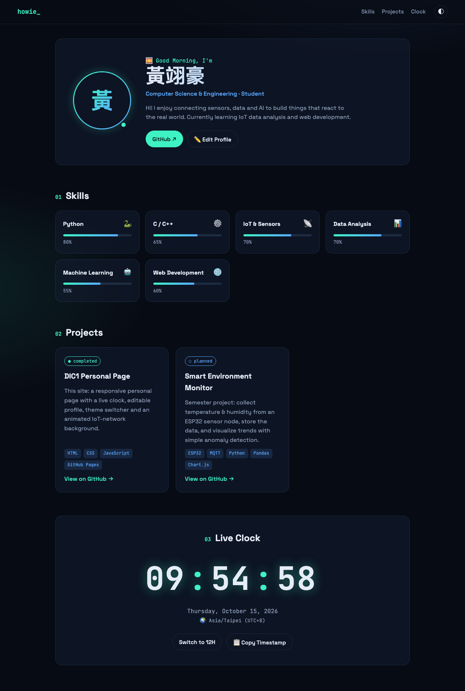

# AIoT-DA-DIC1 · Personal Page

**黃翊豪 (Howie)** — my personal page for the DIC1 course: a static site (HTML / CSS / JavaScript) hosted on GitHub Pages.

🔗 **Live:** https://howie0715.github.io/AIoT-DA-DIC1/



## Features

### Basic requirements
| # | Requirement | Implementation |
|---|---|---|
| 1 | Profile | Name, avatar, role, short bio |
| 2 | Skills | 6 skill cards with animated level bars |
| 3 | Projects | Project cards with description, tech tags and GitHub link |
| 4 | Live Clock | `HH : MM : SS`, updated every second with `setInterval` |
| 5 | Personal Design | Dark "IoT network" theme, glassmorphism cards, Space Grotesk + JetBrains Mono fonts |

### Bonus
- 🌅 Greeting changes with the time of day (Morning / Afternoon / Evening / Night)
- 🔄 12H / 24H toggle
- 🌍 Automatic time zone + UTC offset
- 📋 Copy ISO timestamp to clipboard
- ✏️ Edit the profile in-page (name, role, bio, avatar URL)
- 💾 Theme, clock format and profile saved in `localStorage`
- 🌌 Particle network background that reacts to the mouse
- 🌗 Dark / light theme switch
- ✨ Scroll-reveal animations
- 📱 Responsive layout for phone and desktop

## Files
```
index.html   page structure
style.css    theme, layout, animations
app.js       data (skills/projects), clock, profile editing, particle background
README.md
screenshots/ README screenshot
```

## Customize
Edit the `SKILLS` and `PROJECTS` arrays at the top of `app.js`, and the profile text in `index.html`.

## Run locally
Open `index.html` in a browser, or:
```bash
python3 -m http.server 8000
# then visit http://localhost:8000
```

## Deploy
GitHub repository → **Settings → Pages** → Branch: `main`, Folder: `/ (root)`.
